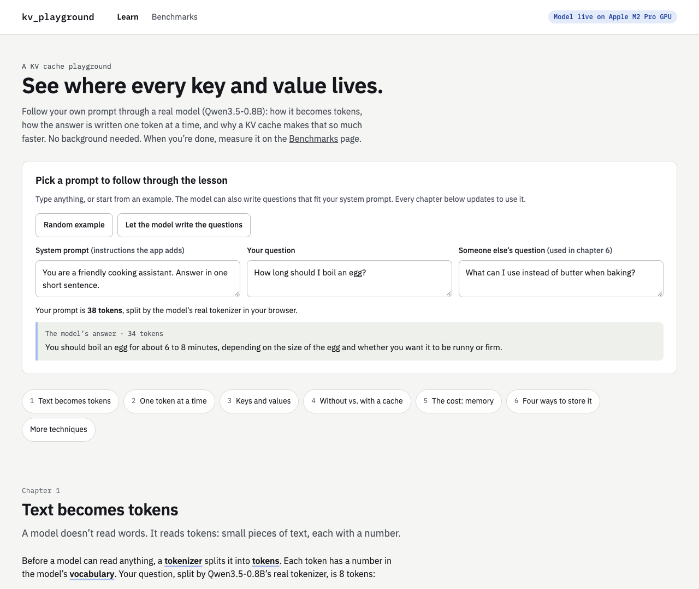
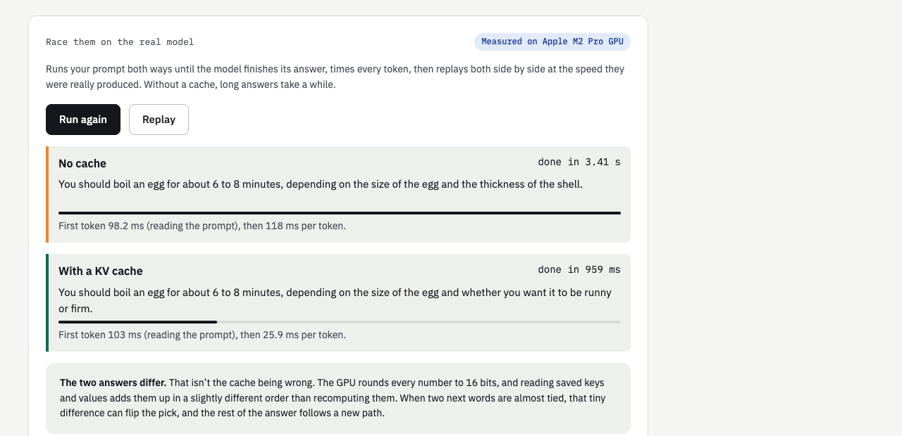
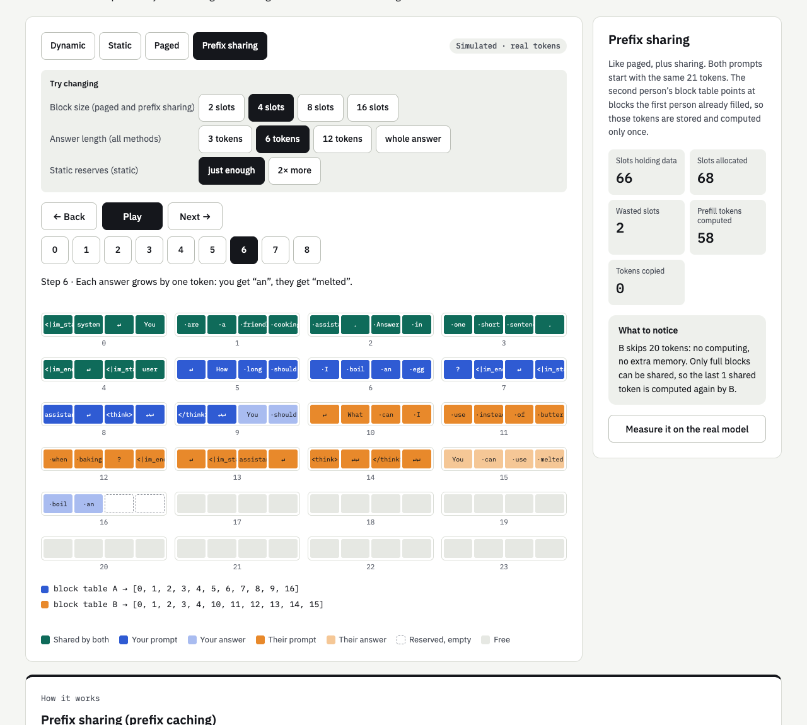
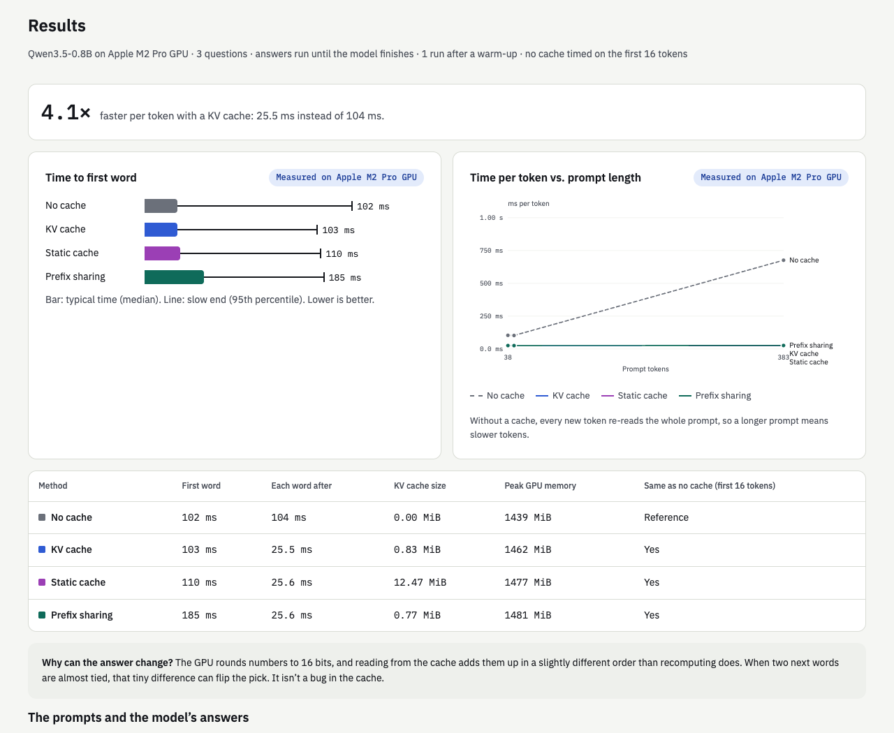

# KV Playground

**Learn how a KV cache works on a real language model, step by step, then measure it.**

Made by Varun M.



KV Playground follows one prompt (yours) through a real model, [Qwen3.5-0.8B](https://huggingface.co/Qwen/Qwen3.5-0.8B).
You see how it becomes tokens, how the answer is written one token at a time, what keys and values are, why
keeping them in a **KV cache** makes generation so much faster, what that costs in memory, and four ways to lay
the cache out in GPU memory. Then you time every method on your own prompts.

No background is needed. Every chapter introduces its key terms and recaps them in a "Words to know" box.

---

## Contents

- [What's inside](#whats-inside)
- [Setup](#setup)
  - [Requirements](#requirements)
  - [Option A: Docker](#option-a-docker)
  - [Option B: Manual setup](#option-b-manual-setup)
  - [Troubleshooting](#troubleshooting)
- [The Learn page](#the-learn-page)
- [The Benchmarks page](#the-benchmarks-page)
- [Results](#results)
- [How the measurements work](#how-the-measurements-work)
- [How it's built](#how-its-built)
- [Hosting it](#hosting-it)
- [Limitations](#limitations)

---

## What's inside

| Page | What you do there |
|---|---|
| **Learn** (`/`) | Type a prompt, pick a random example, or let the model write one. Follow it through seven short chapters, race "no cache" against "KV cache" on the real model, and play with a memory simulator. |
| **Benchmarks** (`/benchmarks`) | Run your prompts on the real model with no cache, a KV cache, a static cache and prefix sharing. See the timings, the memory, and every answer. |

Two parts make it work:

- **The website** (React + TypeScript). It downloads Qwen's real tokenizer from Hugging Face *into your browser*,
  so every token and count you see is exactly what the model sees, even with nothing else running.
- **The model server** (Python, PyTorch, Hugging Face transformers). It runs the model for the lesson's answers,
  the live race and the benchmarks. Without it, the lesson still works and answer words show as `?`.

The header shows **"Model live on …"** with whatever hardware the server runs on: an NVIDIA GPU's name, an
Apple chip, or `CPU (N cores, no GPU)`. It's read from the server, so it is always right for your machine.

---

## Setup

There are two ways to run KV Playground. **Docker** is the easiest: one command builds everything and runs the
website and the model together. **Manual setup** runs the model directly on your machine, which is the only way
to use an Apple GPU (Docker on a Mac can only use the CPU).

### Requirements

**For Docker (option A)**

| You need | Notes |
|---|---|
| [Docker Desktop](https://www.docker.com/products/docker-desktop/) (Mac, Windows) or Docker Engine with the Compose plugin (Linux) | Compose v2 or later: check with `docker compose version`. |
| About 4 GB of free disk space | The image is about 1.6 GB (CPU build) and the model about 1.6 GB. |
| About 4 GB of free memory | On Docker Desktop, raise the memory limit in Settings → Resources if needed. |
| *For an NVIDIA GPU (optional):* an NVIDIA driver and the [NVIDIA Container Toolkit](https://docs.nvidia.com/datacenter/cloud-native/container-toolkit/latest/install-guide.html) | Linux, or Windows with WSL 2. The GPU image is several GB larger. |

**For manual setup (option B)**

| Part | You need | Installed from |
|---|---|---|
| Model and backend | Python 3.12 | [python.org](https://www.python.org/downloads/) or your package manager |
| | PyTorch 2.14, Hugging Face transformers 5.20, FastAPI, Uvicorn | `engine/requirements.txt` |
| | The Qwen3.5-0.8B model (about 1.6 GB) | Hugging Face, downloaded automatically (step 1 below) |
| Frontend | Node.js 20 or later, with npm | [nodejs.org](https://nodejs.org/) |
| | React 18, React Router, Vite, TypeScript, Hugging Face tokenizers and jinja | `web/package.json` |
| Both | About 4 GB of free memory and 4 GB of disk | |
| Optional | An NVIDIA GPU with CUDA, or an Apple silicon Mac | Detected automatically; otherwise the CPU is used |

---

### Option A: Docker

**1. Get the code**

```bash
git clone https://github.com/varunmuch/KV-Playground.git kv-playground
cd kv-playground
```

**2. Build and start**

```bash
docker compose up --build -d
```

This builds the website, installs the Python backend into one image, and starts it in the background. The first
start also downloads the model (about 1.6 GB) into a Docker volume called `models`, so later starts are quick.

**3. Open it:** **http://localhost:8000**. The header says "Model live on CPU (… cores, no GPU)" once the model has
loaded.

**Everyday commands**

| What | Command |
|---|---|
| See if it's running | `docker compose ps` |
| Watch the logs (wait for `Ready on …`) | `docker compose logs -f` |
| Check the model server | `curl http://localhost:8000/api/health` |
| Stop it | `docker compose down` |
| Start it again (no rebuild) | `docker compose up -d` |
| Update after `git pull` | `docker compose up --build -d` |
| Download the model ahead of time | `docker compose run --rm kv-playground hf download Qwen/Qwen3.5-0.8B --revision 2fc06364715b967f1860aea9cf38778875588b17` |
| Remove everything, including the downloaded model | `docker compose down -v` |

**Use a different port:** in `docker-compose.yml`, change `"8000:8000"` to, for example, `"8080:8000"`, then open
http://localhost:8080.

**Use an NVIDIA GPU**

1. Install the NVIDIA driver and the NVIDIA Container Toolkit (see Requirements).
2. In `docker-compose.yml`, uncomment the `deploy:` block.
3. Build with GPU-enabled PyTorch:
   ```bash
   TORCH=cuda docker compose up --build -d
   ```
   The header should now name your GPU, for example "Model live on NVIDIA GeForce RTX 4090".

**Without Docker Compose**

```bash
docker build --build-arg TORCH=cpu -t kv-playground .        # TORCH=cuda for an NVIDIA GPU
docker run -d --name kv-playground -p 8000:8000 -v kv-models:/models kv-playground
#   add --gpus all to the run command for an NVIDIA GPU
docker logs -f kv-playground                                 # wait for "Ready on …"
docker stop kv-playground && docker rm kv-playground         # stop and remove
```

---

### Option B: Manual setup

Use two terminals: one for the model server (backend), one for the website (frontend).

**Step 1: Install the backend and the model**

```bash
cd engine
python3.12 -m venv .venv                    # a private Python environment for this project
.venv/bin/pip install -r requirements.txt   # PyTorch, transformers, FastAPI, Uvicorn

# Optional: download the model now (otherwise it downloads the first time the server starts)
.venv/bin/hf download Qwen/Qwen3.5-0.8B --revision 2fc06364715b967f1860aea9cf38778875588b17
```

- The model comes from [Hugging Face](https://huggingface.co/Qwen/Qwen3.5-0.8B), about 1.6 GB, into
  `~/.cache/huggingface`. No account or API key is needed. To store it elsewhere, set `HF_HOME=/path/to/folder`.
- It's pinned to one revision so the server and the website's tokenizer always match.
- **Windows:** use `py -3.12 -m venv .venv`, and `.venv\Scripts\pip` / `.venv\Scripts\python` / `.venv\Scripts\hf`.
- **NVIDIA GPU on Windows:** pip's default PyTorch is CPU-only there. First install the CUDA build of PyTorch from
  [pytorch.org](https://pytorch.org/get-started/locally/), then run the `requirements.txt` install.
- **Any NVIDIA GPU:** `.venv/bin/pip install flash-linear-attention` makes this model noticeably faster.

**Step 2: Start the backend (model server)**

```bash
cd engine
.venv/bin/python server.py
```

Wait for `Ready on http://127.0.0.1:8000 (<your hardware>)`. It picks the hardware automatically: an NVIDIA GPU,
then an Apple GPU, then the CPU. The model uses about 1.5 GB of memory. Keep this terminal open.

**Step 3: Install and start the frontend (website)**

```bash
cd web
npm install       # first time only
npm run dev
```

Open **http://localhost:5173**. The development site sends `/api` requests to the model server on port 8000.

**Step 4: Check it works**

- The header shows "Model live on …" with your hardware.
- On the Learn page, the model's answer appears under your prompt.
- On the Benchmarks page, **Run benchmark** is enabled.

**Run both from one process instead** (like the Docker image does):

```bash
cd web && npm run build                     # builds the website into web/dist
cd ../engine && .venv/bin/python server.py --site ../web/dist
```

Then open http://localhost:8000.

**Run the tests:** `cd web && npm test` (memory simulator and model-size calculations).

---

### Troubleshooting

| Problem | Fix |
|---|---|
| `address already in use` | Something else uses port 8000. Stop it, or start the server with `--port 8001` (and run the dev site with `VITE_LAB_API=http://127.0.0.1:8001 npm run dev`). In Docker, change the port in `docker-compose.yml`. |
| The header never shows "Model live" | The model server isn't running or hasn't finished loading. Check its terminal (or `docker compose logs -f`) for `Ready on …`. |
| Answers show as `?` on the Learn page | Same: the page works without the model server, but needs it for the model's answers. |
| Very slow on a Mac or a CPU | Expected. This model's linear-attention layers use slower fallback code there; the comparisons are still valid. |
| The model download fails | Hugging Face must be reachable the first time. Check your connection or proxy. |
| Docker build runs out of memory or disk | Give Docker Desktop more memory and disk in Settings → Resources. |
| `python3.12: command not found` | Install Python 3.12, or use the Python 3.12 path on your system. |

---

## The Learn page

At the top you choose the prompt that every chapter uses: a **system prompt** (instructions the app adds), **your
question**, and **someone else's question** (used in chapter 6). Use **Random example**, or **Let the model write
the questions** to have the model write two that fit your system prompt. Below the boxes, the model's full answer
appears as soon as it's written.

| # | Chapter | What you learn | Try this |
|---|---|---|---|
| 1 | **Text becomes tokens** | A model reads numbered pieces of text, not words. The app wraps your message in a chat template with special tokens. | Type a long, unusual word and watch it split. Show the token numbers. |
| 2 | **Prefill, then one token at a time** | *Prefill* reads the whole prompt at once; *decoding* adds one token per step. Every step looks at all earlier tokens. | Press Play and watch the real answer appear token by token. |
| 3 | **Keys and values** | *Attention*: each token leaves a key (a label) and a value (the content); the new token's query finds the matching ones. They never change once computed. | Follow the diagram from the newest token back to every key. |
| 4 | **Without a cache vs. with a KV cache** | Without a cache, every step recomputes the whole sequence; with one, each step computes one token and reads the rest. | Step through the orange/green grids, then **Start the race** on the real model. |
| 5 | **The cost: memory** | Bytes per token, calculated from the model's config (12 KiB here), and how it grows with conversation length and people at once. | Switch between 1,000 and 262,144 tokens, and 1 to 100 people. |
| 6 | **Four ways to store the cache** | Dynamic, static, paged and prefix sharing, simulated with your real tokens. Allocation, fragmentation, paging, block tables and prefix caching. | Change block size, answer length and static reservation; read the step-by-step guide for each method. |
| 7 | **More caching techniques** | Quantization, CPU offloading, sliding windows, eviction (attention sinks), and the fixed-size memory layers this model uses. | Compare 16-, 8- and 4-bit cache sizes for this model. |





### The four cache layouts at a glance

| Method | How it stores the cache | Wasted memory | Copying | Reuses work across people | Used in |
|---|---|---|---|---|---|
| **Dynamic** | One continuous block per person, made bigger (and copied) every token | None | Whole cache, every step | No | Hugging Face transformers' default `DynamicCache` |
| **Static** | A fixed area reserved up front for the longest possible answer | Most of the reservation | None | No | `StaticCache`, compiled and on-device inference |
| **Paged** | Small fixed-size blocks handed out on demand, tracked in a block table | Under one block per person | None | No | vLLM (PagedAttention), SGLang, TensorRT-LLM, TGI |
| **Prefix sharing** | Paged, plus blocks two prompts have in common are stored and computed once | Under one block per person | None | Yes, shared prompt starts | vLLM prefix caching, SGLang RadixAttention, API prompt caching |

---

## The Benchmarks page

1. Write a system prompt and up to four questions, or use **Random example**, **Let the model write a question**,
   or **Add a long question** (a 383-token passage, to see how prompt length matters).
2. Choose **Quick · 1 run** or **Steadier · 3 runs**.
3. Press **Run benchmark**. While it runs you see which method is answering which question, token by token.

You get:

- **Headlines:** how many times faster each token is with a KV cache, and how much sooner the first word arrives
  with prefix sharing on questions that could reuse the cached system prompt.
- **Time to first word** chart (median bar, 95th-percentile line).
- **Time per token vs. prompt length** chart, when your questions differ a lot in length.
- **Results table:** first word, each word after, KV cache size, peak GPU memory, and whether each method's answer
  matches "No cache".
- **The prompts and the model's answers:** the full answer to each question, and any method that wrote something
  different.
- **Download the raw numbers** as JSON.

| Term | Meaning |
|---|---|
| Time to first token (TTFT) | How long until the answer starts. Mostly prefill: reading the prompt. |
| Time per output token | How long each later token takes. This is where the KV cache helps most. |
| Median / p95 | The middle observation and the estimated 95th percentile. With only 1–3 repeats per prompt, p95 is descriptive, not a stable tail-latency estimate. |
| Warm-up | An untimed first run so one-off GPU start-up costs don't count against any method. |
| Baseline | "No cache": every other method's answer is compared with it. |
| Greedy decoding | The model always picks its most likely next token, so runs are repeatable. |

---

## Results

Measured on an **Apple M2 Pro GPU** (16 GB of memory) with the Benchmarks page's “Steadier · 3 runs” setting,
on 2026-10-18. The raw numbers are in [`docs/results/`](docs/results/); run the same prompts yourself to get
numbers for your hardware.

**Prompts:** the system prompt *“You are a friendly cooking assistant. Answer in one short sentence.”* and three
questions: *“How long should I boil an egg?”* (38 prompt tokens), *“What can I use instead of
butter when baking?”* (40), and the built-in long question, a passage about the history of bread
to summarise (383).



### Headline numbers

| | No cache | KV cache | |
|---|---|---|---|
| Time per token, short questions | 103 ms | 24.7 ms | **4.2× faster** |
| Time per token, 383-token question | 658 ms | 24.5 ms | **27× faster** |
| Time to first token, short questions | 98.8 ms | 98.8 ms | about the same: both read the prompt once |

Without a cache, the time per token grows with the length of everything before it (103 ms
at 38 tokens, 658 ms at 383). With a cache it was roughly flat across these measured prompts (about 24.5 ms). Longer contexts can still increase decoding cost; these results do not establish constant-time decoding.

### All methods

| Method | Time to first token (median / p95) | Time per token | KV cache size | Peak GPU memory | Same answer as no cache (first 16 tokens) |
|---|---|---|---|---|---|
| No cache | 99.3 ms / 584 ms | 103.5 ms | 0.00 MiB | 1,439 MiB | — |
| KV cache | 99.4 ms / 588 ms | 24.5 ms | 0.83 MiB | 1,462 MiB | Yes |
| Static cache | 108 ms / 596 ms | 24.5 ms | 12.47 MiB | 1,478 MiB | Yes |
| Prefix sharing | 177 ms / 597 ms | 24.7 ms | 0.77 MiB | 1,481 MiB | Yes |

The p95 values are high for every method because they include the 383-token question, which takes
about 0.6 s to read; the medians are the short questions.

**What to notice**

- **The KV cache is the big win:** every token after the first is 4.2× faster on short prompts and
  27× faster on the long one, and the advantage keeps growing with length.
- **Static cache costs memory, not speed:** it reserves room for a 1,024-token answer, so it holds
  12.5 MiB instead of 0.83 MiB, with the same time per token on this hardware. Its real
  benefit, compiling the model ahead of time, isn't used here.
- **Prefix sharing pays off on repeated system prompts:** the second question reused 21 cached tokens and
  its first token arrived in 87.0 ms instead of 99.2 ms. The first question pays a little extra
  (177 ms) because it saves the cache for the others. On the long question, the 21 shared tokens are
  a small part of 383, so the saving is small too. Long shared prefixes (big system prompts, chat history,
  agents) are where it matters.
- **Answers:** in this run every method's answer started exactly like the no-cache answer. In other runs they can
  drift apart after a few dozen tokens because of 16-bit rounding (see [How the measurements work](#how-the-measurements-work)).

### The race (Learn page, chapter 4)

The egg question, whole answers, on the same GPU:

| | First token | Then, per token | Whole answer |
|---|---|---|---|
| No cache | 98.3 ms | 110 ms | 3.17 s (29 tokens) |
| KV cache | 100 ms | 24.5 ms | 0.91 s (34 tokens) |

The two answers were *“You should boil an egg for about 6 to 8 minutes, depending on the size of the egg and the thickness of the shell.”* (no cache) and *“You should boil an egg for about 6 to 8 minutes, depending on the size of the egg and whether you want it to be runny or firm.”* (KV cache). They match up to “…the size of the egg and”, then go different ways: an example of the rounding
effect, not a mistake in the cache.

### The same benchmark on a CPU (Docker)

Docker on a Mac can't use the Mac's GPU, so the container runs on the CPU (10 cores, no GPU). Same two short questions,
one run:

| Method | Time to first token | Time per token |
|---|---|---|
| No cache | 686 ms | 725 ms |
| KV cache | 562 ms | 216 ms |
| Static cache | 546 ms | 226 ms |
| Prefix sharing | 820 ms | 223 ms |

Everything is about 9× slower than on the GPU, but the lesson is the same: the KV cache is
3.4× faster per token than no cache.

---

## How the measurements work

All timing code is in [`engine/lab.py`](engine/lab.py).

- **Real model, real prompts.** Qwen3.5-0.8B in bfloat16, prompts built with the model's own chat template
  (thinking turned off), greedy decoding.
- **A hand-written decoding loop**, so the first token (prefill) and every later token are timed separately.
  - *No cache* runs the whole sequence through the model for every new token.
  - *KV cache* (`DynamicCache`) feeds only the newest token and reads the rest from the cache.
  - *Static cache* (`StaticCache`) reserves room for the prompt plus the longest answer allowed (1,024 tokens).
  - *Prefix sharing* saves the cache at the end of the system prompt after the first question, and later questions
    with the same system prompt start from a copy of it. Copying is timed; saving is bookkeeping and isn't.
- **The GPU is synchronised** around every timer (`torch.cuda.synchronize` / `torch.mps.synchronize`); GPU work is
  asynchronous, so without this the timer would only measure launching it.
- **Warm-up:** each method generates a couple of untimed tokens on each prompt first, so GPU kernel set-up isn't
  counted against whichever method happens to run first.
- **Methods take turns going first** on each repeat, so none always benefits from a warm GPU.
- **Answers run until the model finishes** (it emits its end-of-answer token), with a 1,024-token safety stop.
- **"No cache" is timed on the first 16 tokens of each answer in the benchmark.** It re-reads the whole sequence for
  every token, so it gets slower as the answer grows; timing whole answers would take minutes. Because its cost per
  token only rises, this *understates* how slow it is. The live race on the Learn page runs it on the whole answer.
- **Answers are compared token by token** with "No cache". They can differ even though a KV cache is exact in
  principle: the GPU rounds numbers to 16 bits, and reading cached values adds them in a slightly different order than
  recomputing, so when two next words are almost tied, the pick can flip.
- **Memory:** "KV cache size" is the bytes the cache's key and value tensors actually hold. "Peak GPU memory" includes
  the model itself (CUDA reports a true peak; on Apple GPUs it's the largest of two samples).

Sizes on the Learn page are calculated from the model's [`config.json`](https://huggingface.co/Qwen/Qwen3.5-0.8B/blob/main/config.json):
`2 (key + value) × 6 attention layers × 2 KV heads × 256 numbers × 2 bytes = 12,288 bytes per token`. This was checked
against a real cache, which held exactly 12,288 bytes per token.

---

## How it's built

```
Dockerfile, docker-compose.yml   one container: builds the site, runs the server
engine/
  lab.py          the model, the four cache methods, the timing loop, the benchmark
  server.py       HTTP API, and (with --site) serves the built website
web/src/
  pages/learn/       the seven chapters, the live race, the memory simulator and method guide
  pages/benchmarks/  the benchmark form, live progress and results
  simulator/         pure functions for the memory layouts (unit tested)
  qwen/              Qwen's tokenizer and model facts, loaded from the Hugging Face Hub in the browser
  live/              client for the model server
docs/                screenshots and saved benchmark results
```

### Server API

| Endpoint | What it does |
|---|---|
| `GET /api/health` | Model name and the hardware it runs on (shown in the header). |
| `POST /api/generate` | The model's whole answer to a prompt, as tokens (used by the lesson). |
| `POST /api/suggest` | The model writes a question that fits a system prompt. |
| `POST /api/race` | The whole answer with no cache and with a KV cache, every token timed. |
| `POST /api/benchmark` | Times every method on up to four questions; streams progress and tokens, then the result. |

One request uses the model at a time; others wait their turn.

---

## Hosting it

**The simplest way:** run the Docker image on any machine and point a domain at port 8000. The website and the
model are on one address, so there's nothing else to configure. Put HTTPS in front of it (for example Caddy, or a
Cloudflare Tunnel: `cloudflared tunnel --url http://localhost:8000`).

**Website and model on different hosts** (for example the site on Vercel or Netlify, the model on a GPU machine):

1. Website: deploy the `web` folder (build command `npm run build`, output `dist`). Make every path fall back to
   `index.html` (Vercel: a rewrite rule; Netlify: `/*  /index.html  200`). Build with the model server's address:
   `VITE_LAB_API=https://your-model-server.example npm run build`.
2. Model server: `python server.py --host 0.0.0.0 --origins https://your-site.example`, behind HTTPS.

Anyone who can reach the server can use its GPU, so consider a rate limit at your proxy.

---

## Limitations

- **One model.** The site's tokenizer is pinned to one revision of Qwen3.5-0.8B (`web/src/qwen/model.ts`) and the server loads the
  same model (`engine/lab.py`). Change both together to try another.
- **Paged memory is simulated, not measured.** Hugging Face transformers runs paged attention through its
  continuous-batching path, not the single-request loop used here. Quantization, offloading and sliding windows are
  explained but not measured.
- **On Apple GPUs and CPUs, Qwen3.5's linear-attention layers use slow fallback code.** On an NVIDIA GPU, installing
  `flash-linear-attention` makes them much faster.
- **The model is small (0.8B).** Questions it writes for you are sometimes odd; "Random example" is the reliable option.

Set `repoUrl` in `web/src/config/site.ts` to show a "Source on GitHub" link in the footer.
